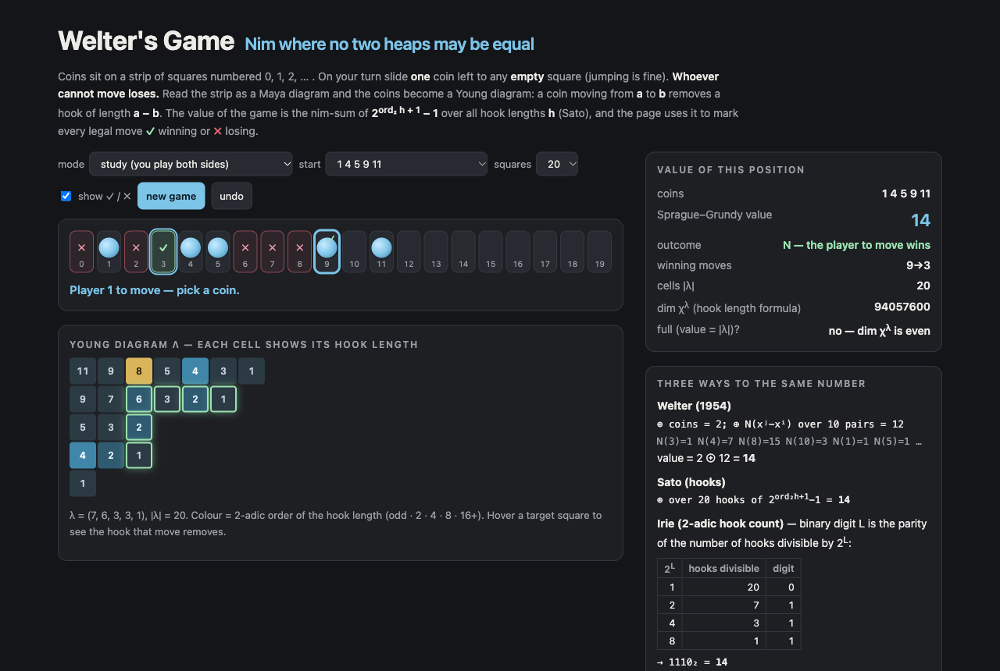

# Welter's Game

Nim in which no two heaps may ever be equal, in the browser. Coins sit on a strip of squares numbered 0, 1, 2, …, at most one per square. On your turn slide **one** coin left to any **empty** square (jumping over coins is fine). **Whoever cannot move loses.** Play against the computer or study positions on your own.

Every position is shown twice: as coins, and as the **Young diagram** that Sato read off the strip (the "Maya game"). Sliding a coin from *a* to an empty *b* removes a hook of length *a − b*. The page computes the Sprague–Grundy value three ways and marks every legal move **✓** (to a position of value 0) or **✗**:

- **Welter (1954):** x¹ ⊕ … ⊕ xᵐ ⊕ ⊕_{i<j} N(xⁱ − xʲ), with N(d) = d ⊕ (d − 1).
- **Sato (hooks):** ⊕ over all hook lengths h of 2^(ord₂ h + 1) − 1.
- **Irie (2-adic hook count):** binary digit L is the parity of the number of hooks whose length is divisible by 2^L.

It also shows |λ|, the dimension of the irreducible representation χ^λ of the symmetric group (hook length formula, exact), and whether the position is **full** — value = |λ|, which by Irie (2018) and Macdonald (1971) happens exactly when that dimension is odd.



## Run it

```sh
npm install
npm run dev        # http://localhost:5173/portfolio/welters-game/
npm test           # 13 tests
npm run build      # static site in dist/
```

## How it works

- `src/welter.ts`: positions are ascending arrays of squares. Welter's formula, the partition λ(X) (λᵢ = xⁱ − (m − i), coins from the top), hook lengths, Sato's formula, Irie's base-p hook count (`btower`) and base-p Welter formula, legal / winning moves, the exact character degree (BigInt), and `bruteForceTable(n)`: plain mex over every coin set inside n squares, indexed by bitmask — a move always lowers the mask, so one increasing pass is a valid order.
- `src/saturation.ts`: Irie's **p-saturations** W^m_{p,k}. Up to k − 1 coins move at once (coins keep their identity, so they may pass each other), legal iff ord_p of the total distance equals the least ord_p of the single distances. The table builder enumerates the m-subsets of a window ordered by coin sum (every option has a smaller sum), ranks them in colex order, and takes mex over options generated coin by coin with a bitmask of final squares. Positions in a window are closed under moves, so every value is exact. `satOptions` is the slow, definition-level option list used by the tests.
- `src/main.ts`: the demo. Rows of the diagram are coins, columns are empty squares; the cell (coin a, empty e) has hook length a − e. Hovering a target square outlines the hook that move removes.

## Checked

```sh
node --max-old-space-size=8192 tools/compute.mts brute <n>        # every coin set in [0, n) by brute-force mex
node tools/compute.mts full <nmax>                                # full positions vs odd degree vs OEIS A059867
node tools/compute.mts msg <p> <nmax>                             # Irie's Theorem 1 (sub-diagram of the same value)
node tools/compute.mts sat <p> <m> <k> <n>                        # W^m_{p,k} on [0, n) vs the base-p hook count
node tools/report.mts                                             # runs/summary.json, src/findings.json
```

<!-- results:start -->
| check | size | result |
|---|---|---|
| Welter's formula, Sato's hook formula, 2-adic hook count vs brute-force mex | every coin set inside 26 squares, 67,108,864 positions (partition-based formulas on the 262,144 sets inside 18) | **0 mismatches**, 212.7 s |
| P-positions by number of coins in [0, 26) | 0:1 1:1 2:13 3:90 4:518 5:2,098 6:7,318 7:20,690 8:49,195 9:98,095 10:166,631 11:241,876 12:302,660 13:325,948 14:302,660 15:241,876 16:166,631 17:98,095 18:49,195 19:20,690 20:7,318 21:2,098 22:518 23:90 24:13 25:1 26:1 | symmetric under c ↔ 26 − c (coins ↔ holes = conjugate diagram, same hooks) |
| full positions (value = \|λ\|) = odd dim χ^λ = OEIS A059867 | every partition of n ≤ 72, 40,143,941 partitions | **all 72 terms identical**, 114 s |
| Irie Thm 1: a sub-diagram μ with \|μ\| = value(μ) = value(λ), p = 2 | every partition of n ≤ 40, 215,308 partitions | 0 failures |
| Irie Thm 1: a sub-diagram μ with \|μ\| = value(μ) = value(λ), p = 3 | every partition of n ≤ 40, 215,308 partitions | 0 failures |
| Irie Thm 1: a sub-diagram μ with \|μ\| = value(μ) = value(λ), p = 5 | every partition of n ≤ 30, 28,629 partitions | 0 failures |

**p-saturations** W^m_{p,k} on the window [0, n) vs Irie's base-p hook count (k − 1 = most coins that may move at once; Irie: sat_p(W^m) ≥ min(p, m + 1), exact value unknown for 3 ≤ p ≤ m):

| p | m | k | window | positions | differ | first difference (least coin sum) | time |
|---|---|---|---|---|---|---|---|
| 2 | 4 | 2 | [0, 24) | 10,626 | 0 | — | 0.1 s |
| 3 | 3 | 2 | [0, 20) | 1,140 | **1,060** | {0, 2, 4}: value 1, hook count 3 | 0 s |
| 3 | 3 | 3 | [0, 31) | 4,495 | 0 | — | 0.2 s |
| 3 | 3 | 4 | [0, 28) | 3,276 | 0 | — | 0.3 s |
| 3 | 4 | 2 | [0, 24) | 10,626 | **10,264** | {0, 1, 3, 5}: value 1, hook count 3 | 0.1 s |
| 3 | 4 | 3 | [0, 30) | 27,405 | 0 | — | 1.3 s |
| 3 | 4 | 3 | [0, 31) | 31,465 | 0 | — | 2.5 s |
| 3 | 4 | 4 | [0, 24) | 10,626 | 0 | — | 2.8 s |
| 3 | 4 | 4 | [0, 28) | 20,475 | 0 | — | 9.7 s |
| 3 | 4 | 5 | [0, 20) | 4,845 | 0 | — | 1.4 s |
| 3 | 5 | 3 | [0, 26) | 65,780 | 0 | — | 4.4 s |
| 3 | 5 | 3 | [0, 28) | 98,280 | 0 | — | 11.4 s |
| 3 | 5 | 4 | [0, 22) | 26,334 | 0 | — | 9.1 s |
| 3 | 5 | 4 | [0, 24) | 42,504 | 0 | — | 28.8 s |
| 3 | 6 | 3 | [0, 22) | 74,613 | 0 | — | 5.4 s |
| 3 | 6 | 3 | [0, 25) | 177,100 | 0 | — | 22.9 s |
| 3 | 7 | 3 | [0, 23) | 245,157 | 0 | — | 43.4 s |
| 3 | 8 | 3 | [0, 22) | 319,770 | 0 | — | 56 s |
| 4 | 3 | 3 | [0, 24) | 2,024 | **132** | {4, 5, 6}: value 0, hook count 12 | 0.1 s |
| 4 | 4 | 4 | [0, 22) | 7,315 | 0 | — | 1.8 s |
| 4 | 5 | 4 | [0, 21) | 20,349 | 0 | — | 9.2 s |
| 5 | 4 | 4 | [0, 24) | 10,626 | **159** | {5, 6, 7, 8}: value 0, hook count 20 | 2 s |
| 5 | 5 | 4 | [0, 22) | 26,334 | **735** | {0, 6, 7, 8, 9}: value 0, hook count 20 | 8.7 s |
| 5 | 5 | 5 | [0, 20) | 15,504 | 0 | — | 17.3 s |
| 5 | 5 | 5 | [0, 22) | 26,334 | 0 | — | 68.8 s |
| 5 | 6 | 5 | [0, 19) | 27,132 | 0 | — | 78.8 s |
<!-- results:end -->

## Sources

- C. P. Welter, *The theory of a class of games on a sequence of squares, in terms of the advancing operation in a special group*, Indagationes Mathematicae 57 (1954) 194–200.
- M. Sato, *On a game* (Proc. 12th Symposium of the Algebra Section, 1968) and *Mathematical theory of Maya game*, RIMS Kôkyûroku 98 (1970) 105–135 (both in Japanese).
- Y. Irie, *p-Saturations of Welter's game and the irreducible representations of symmetric groups*, J. Algebraic Combin. 48 (2018) 247–287, [arXiv:1604.07214](https://arxiv.org/abs/1604.07214).
- I. G. Macdonald, *On the degrees of the irreducible representations of symmetric groups*, Bull. LMS 3 (1971).
- OEIS [A059867](https://oeis.org/A059867) (`data/a059867-b.txt` is its b-file).

## License

MIT © SEN LLC
